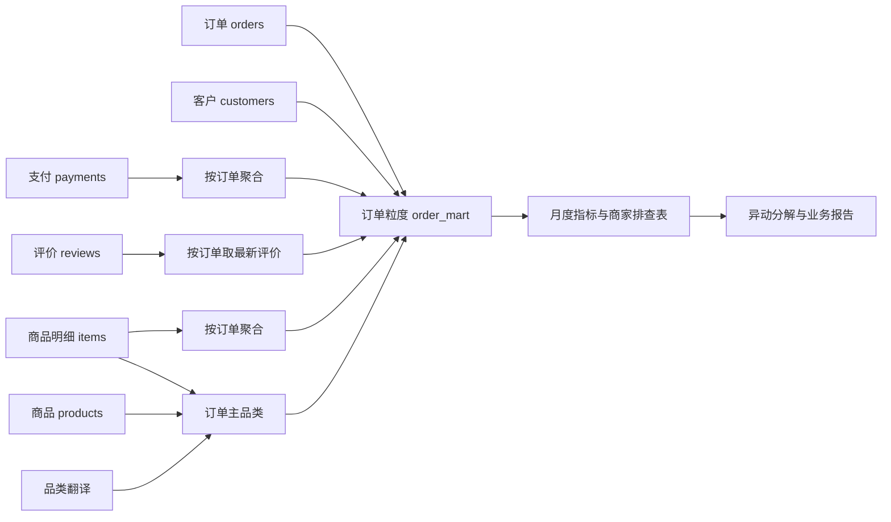

# 电商履约与客户体验诊断

**问题：哪些履约环节值得优先排查？延迟与差评有多大关联？**

直接阅读 [业务报告](reports/REPORT.md) 或打开 [HTML 图文报告](reports/REPORT.html)。结果来自 99,441 笔真实公开历史订单，未生成模拟数据。

## 技术路线

DuckDB SQL 完成多表聚合、ROW_NUMBER 去重、宽表建模、LAG 环比、滚动窗口、商家 DENSE_RANK；Python 完成数据核验、对称结构分解、Wilson 下界、敏感性分析与绘图。



商家原始表另用于外键完整性校验；订单宽表仅保留单商家订单的 seller_id，防止多商家订单被重复归责。customer_id 是订单关联键，customer_unique_id 才用于识别跨订单客户；本项目不以 customer_id 计算复购。

## 指标字典

| 指标 | 口径/分母 | 注意 |
|---|---|---|
| 原始订单量 | orders 行数，order_id 唯一 | 包含取消和未送达 |
| 分析订单 | 2017-01 至 2018-08 下单、已送达、实际和预计送达非空且实际不早于下单 | 不包含未完成订单，存在选择偏差 |
| 商品金额 | SUM(items.price)，先按订单聚合 | BRL，不含运费，不是净利润 |
| 支付金额 | SUM(payments.payment_value) | 与商品+运费不一致时输出例外，不自动改写 |
| 客单价 | 分析订单商品金额合计 / 分析订单数 | 个别商品信息缺失若存在需解释；当前源数据对账输出完整 |
| 延迟率 | 实际送达日 > 预计送达日的分析订单 / 分析订单 | 比较日期，不比较午夜时间 |
| 差评率 | 最新评价为1–2星的订单 / 有评价订单 | 无评价不作为好评 |
| 3月滚动延迟率 | 近3个月延迟订单总和 / 订单总和 | 不对月度百分比做简单平均；开头不足3月用已有月份 |
| 商家排查优先级 | 至少100单、仅单商家订单，按延迟单数降序 | 同看延迟率和Wilson下界；不是处罚或因果归责 |
| 地区结构分解 | 平均权重×率差 + 平均率×权重差 | 只说明算术贡献，不识别外部根因 |

## 运行

安装依赖并下载数据后，在本仓库根目录运行：

```bash
python run.py
```

首次缺少数据时先运行 `python download_data.py`。无需数据库服务、账号密钥或付费 API。SQL 使用 DuckDB 方言；若迁移到 MySQL，需调整 DATE_TRUNC、FILTER、SEMI/ANTI JOIN 等语法。

## 文件

- `sql/01_order_mart.sql`：聚合、去重、订单宽表和分析视图。
- `sql/02_monthly_metrics.sql`：月度经营指标、LAG、加权滚动窗口。
- `sql/03_seller_priority.sql`：商家数量与比例双维度排查。
- `run.py`：导入、20项质量断言、异动分解、敏感性分析、自动报告。
- `reports/*.csv`：每张结果表都保留，报告数字可核查。
- `data/processed/olist.duckdb`：本地分析库，可继续写 SQL。

## 面试讲解

1. 用两个商品、两个支付记录说明直接 JOIN 为什么会放大金额；演示先聚合后 JOIN，并对源表合计做核验。
2. 解释为什么同一天18点送达不应被预计日期午夜误判为延迟。
3. 解释评价去重规则、混合商家归责限制与未完成订单的选择偏差。
4. 讲清 2018-02 的上升主要来自地区内部率变化，而不是订单流向变化；不能凭这一步就断言具体物流原因。
5. 主关联差距在评价时点敏感性分析中明显缩小；主动说明这一点，比只展示最大的差距更可信。

## 数据归属

[Olist 官方发布数据](https://www.kaggle.com/datasets/olistbr/brazilian-ecommerce)，许可按来源 CC BY-NC-SA 4.0。原始数据不进入发布包，不随本项目代码再授权。报告仅为公开数据作品集分析，并非与 Olist 的合作项目。

## 独立安装与复现

本仓库完全独立，包含自己的源码、SQL、依赖、数据下载器、测试和报告，不依赖其他作品集仓库。

```powershell
git clone https://github.com/SRTURK/olist-operations-analysis.git
cd olist-operations-analysis
python -m venv .venv
.\.venv\Scripts\python.exe -m pip install -r requirements-lock.txt
.\.venv\Scripts\python.exe download_data.py
.\.venv\Scripts\python.exe run.py
.\.venv\Scripts\python.exe -m unittest discover -s tests -v
```

建议 Python 3.12。macOS/Linux 将 Python 入口换成 `.venv/bin/python`。先生成报告，再运行依赖分析产物的测试。分析及测试不需要联网；首次安装和下载数据需要联网。

`requirements-lock.txt` 记录本次运行的锁定环境，`requirements.txt` 提供兼容范围。`data_manifest.json` 保存原始文件来源和SHA256，下载脚本会核对文件与已记录版本一致，不自动覆盖参考哈希。原始数据和生成数据库通过 `.gitignore` 排除。

完成验证：20项分析断言、2项测试。图表、报告和汇总结果位于 `reports/`。
