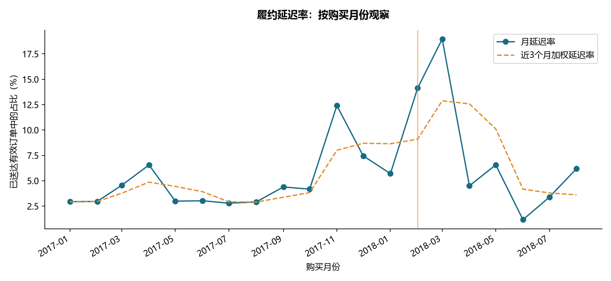
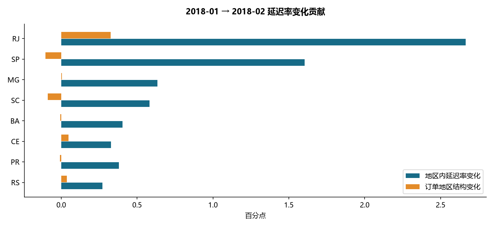
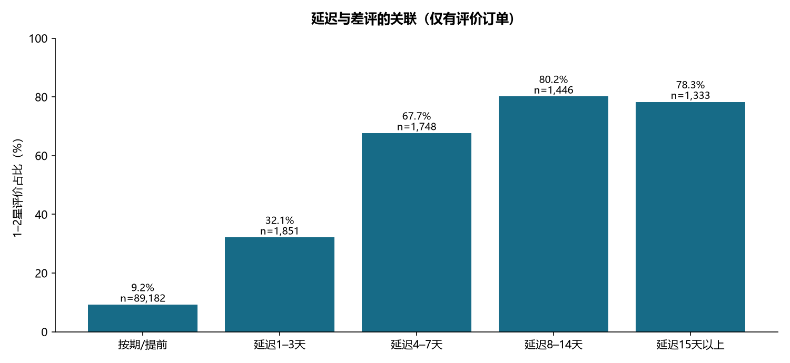

# 电商履约与客户体验诊断

完成日期：2026-10-23 · SQL + Python · 公开历史数据的回顾性诊断

## 业务结论

1. 原始订单 **99,441** 笔，主分析纳入 **96,203** 笔 2017-01 至 2018-08 的有效已送达订单，延迟率 **6.79%**。
2. 未聚合就连接商品明细与支付明细，会使匹配订单的商品金额高估 **4.54%**。已通过先聚合再关联修复，并与源表金额对账。
3. 延迟订单差评率 **62.42%**，按期订单 **9.25%**，相差 **53.17 个百分点**。限制到送达当日或之后创建的评价，二者变为 **25.11%** 与 **9.23%**，说明评价时点影响很大。这些都是关联，不能推断改善配送一定带来同等幅度的评分提升。
4. 最大月度恶化出现在 **2018-01 → 2018-02**：全样本延迟率上升 **8.43 个百分点**。共同地区样本分解中，地区内部变化贡献 **8.15 个百分点**，地区订单结构贡献 **0.28 个百分点**。

## 数据口径与质量

来源：[Olist 发布页](https://www.kaggle.com/datasets/olistbr/brazilian-ecommerce)。原始 CSV、下载来源和 SHA256 见根目录 data_manifest.json；没有生成模拟业务数据。数据为 2016–2018 年历史数据，结论不代表当前 Olist 经营状况。

|   total_orders |   delivered_status |   eligible_all_dates |   invalid_delivered |   no_review |   no_items |   no_payment |   amount_mismatch |   multi_seller_orders |
|---------------:|-------------------:|---------------------:|--------------------:|------------:|-----------:|-------------:|------------------:|----------------------:|
|          99441 |              96478 |                96470 |                   8 |         768 |        775 |            1 |               260 |                  1278 |

- 数据库加载订单、商品明细、支付、评价、客户、商品、商家、品类翻译 8 张表；地理坐标文件保留但未用于分析。
- 日期按原数据的无时区本地时间解析。延迟定义为实际送达**日历日期**晚于预计送达日，避免把当天午夜之后的送达都算延迟。
- 差评定义为 1–2 星；无评价不计为好评。一个订单只保留最后答复的评价（ROW_NUMBER），共折叠 551 条额外评价记录。时间并列按 review_id、源文件行号确定性排序。
- 商品金额不含运费；支付金额含运费且可能存在业务差异。误差大于 0.05 巴西雷亚尔的订单单独输出，未强行覆盖。两类金额与各自源表分别对账。
- 商家排查只使用单商家订单，至少 100 单；混合品类订单按商品金额最大的品类归类，仅供订单诊断。
- 全部 **20 项断言通过**；详细数值见 validation_checks.csv。金额例外见 payment_reconciliation_exceptions.csv。

原始订单状态：

| order_status   |   orders |
|:---------------|---------:|
| delivered      |    96478 |
| shipped        |     1107 |
| canceled       |      625 |
| unavailable    |      609 |
| invoiced       |      314 |
| processing     |      301 |
| created        |        5 |
| approved       |        2 |

主分析仅包含已送达订单，存在完成订单选择；取消/未送达订单不应据此视为正常履约。2018-09 后记录稀疏，排除整段尾部；月末订单仍可能受提取时点与送达状态筛选影响。缺少可信的数据快照日，不能宣称彻底消除了右删失。

## 指标异动：从总量到地区

选择规则在代码中固定为“相邻两月均不少于 1,000 单的最大延迟率正向变化”，属于探索性定位，未把筛选后的峰值当作独立显著性检验。

对共同覆盖的 27 个地区使用对称分解：地区内贡献 = 平均订单权重 × 延迟率变化；结构贡献 = 平均延迟率 × 权重变化。共同地区覆盖前月 100.00%、当月 100.00%。两项之和等于共同地区总变化（已断言核验）。

| state   |   n0 |   n1 |     r0 |     r1 |   within_effect |   mix_effect |
|:--------|-----:|-----:|-------:|-------:|----------------:|-------------:|
| RJ      |  850 |  879 | 0.1306 | 0.3402 |          0.0267 |       0.0033 |
| SP      | 2975 | 2632 | 0.0343 | 0.0733 |          0.0161 |      -0.0010 |
| MG      |  846 |  790 | 0.0307 | 0.0835 |          0.0063 |       0.0000 |
| SC      |  311 |  254 | 0.0997 | 0.2402 |          0.0058 |      -0.0009 |
| BA      |  228 |  208 | 0.0658 | 0.1923 |          0.0040 |      -0.0001 |
| CE      |   77 |   84 | 0.1169 | 0.3929 |          0.0033 |       0.0005 |
| PR      |  371 |  335 | 0.0162 | 0.0896 |          0.0038 |      -0.0001 |
| RS      |  367 |  363 | 0.0817 | 0.1322 |          0.0027 |       0.0004 |

表中率和贡献均为小数比例；乘以 100 得到百分比或百分点。这是算术分解，不能解释为物流供应商、天气或罢工等原因；数据没有这些外部变量。

## 延迟与客户体验

| delay_bucket   |   orders |   reviewed |   bad_reviews |   bad_review_rate |   review_coverage |
|:---------------|---------:|-----------:|--------------:|------------------:|------------------:|
| 按期/提前          |    89672 |      89182 |          8247 |            0.0925 |            0.9945 |
| 延迟1–3天         |     1869 |       1851 |           595 |            0.3214 |            0.9904 |
| 延迟4–7天         |     1802 |       1748 |          1183 |            0.6768 |            0.9700 |
| 延迟8–14天        |     1478 |       1446 |          1159 |            0.8015 |            0.9783 |
| 延迟15天以上        |     1382 |       1333 |          1044 |            0.7832 |            0.9645 |

评价可能在实际送达前创建。补充限制“评价创建日期不早于送达日期”后得到：

|   is_late |     n |   bad_rate |
|----------:|------:|-----------:|
|         0 | 88961 |     0.0923 |
|         1 |  1629 |     0.2511 |

该敏感性筛选也会改变人群，不能消除所有混杂。地区、品类、商家服务与订单难度都可能同时影响延迟和评价。

## 建议排查顺序

1. 优先调查峰值月份中贡献最大的地区，再交叉检查 category_month_diagnostic.csv 中的品类变化，核实是普遍运力问题还是具体线路/品类问题。
2. 对 seller_priority.csv 前 10 个高延迟数量商家做运营核查。这些商家（每家至少 100 个单商家有效订单）的延迟单合计占全部分析延迟订单 **15.60%**；这是可排查覆盖面，不是可承诺消除的损失。
3. 同时看绝对延迟单数、延迟率及 Wilson 95% 下界，避免小样本商家误入榜单。下界是单商家的描述性区间，不是多重比较校正后的处罚依据。
4. 若实施预计到货提示或物流分流，另行做随机试点，并同时观察延迟率、取消率、投诉/退货和成本；本数据没有线上干预效果。

前 10 个排查对象（匿名商家 ID）：

| seller_id                        |   orders |   late_orders |   late_rate |   late_rate_wilson_lower |   bad_review_rate |
|:---------------------------------|---------:|--------------:|------------:|-------------------------:|------------------:|
| 4a3ca9315b744ce9f8e9374361493884 |     1673 |      168.0000 |      0.1004 |                   0.0869 |            0.1698 |
| 1f50f920176fa81dab994f9023523100 |     1364 |      124.0000 |      0.0909 |                   0.0768 |            0.1288 |
| 4869f7a5dfa277a7dca6462dcf3b52b2 |     1111 |      118.0000 |      0.1062 |                   0.0894 |            0.1224 |
| ea8482cd71df3c1969d7b9473ff13abc |     1116 |       96.0000 |      0.0860 |                   0.0710 |            0.1387 |
| 6560211a19b47992c3666cc44a7e94c0 |     1788 |       95.0000 |      0.0531 |                   0.0437 |            0.1539 |
| 7c67e1448b00f6e969d365cea6b010ab |      963 |       89.0000 |      0.0924 |                   0.0757 |            0.2508 |
| cc419e0650a3c5ba77189a1882b7556a |     1646 |       87.0000 |      0.0529 |                   0.0430 |            0.1285 |
| da8622b14eb17ae2831f4ac5b9dab84a |     1272 |       85.0000 |      0.0668 |                   0.0544 |            0.1058 |
| 8b321bb669392f5163d04c59e235e066 |      917 |       80.0000 |      0.0872 |                   0.0707 |            0.1347 |
| 955fee9216a65b617aa5c0531780ce60 |     1252 |       77.0000 |      0.0615 |                   0.0495 |            0.0997 |

## 复现与交付

在本仓库目录运行 `python run.py`。原始数据 → 8 张原始表 → 聚合/去重中间表 → 订单宽表 → SQL 指标 → Python 分解与图表 → 本报告。数据关系、指标字典与面试说明见项目 README.md。
